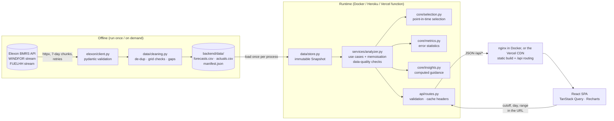

# Architecture

## 1. Data flow

The browser never waits on Elexon. Every request is computed from the in-memory snapshot (~20k
forecast rows) in milliseconds and memoised, and responses carry `Cache-Control` headers so the Vercel
CDN can cache them too.

## 2. Module responsibilities

| Layer | Module | Responsibility | Depends on |
|---|---|---|---|
| Ingestion | `app/elexon/client.py` | Typed calls to the two stream endpoints, chunking, retry/backoff, record models | httpx, pydantic |
| | `app/data/cleaning.py` | Validate rows, drop invalid/duplicates, keep latest FUELHH revision, count off-grid timestamps and gaps | client models |
| | `scripts/ingest.py` | Orchestrate fetch → clean → write snapshot + manifest (row counts, checksums) | the above |
| Storage | `app/data/store.py` | Read/write CSV snapshot, cached `get_snapshot()` | pandas |
| Domain (pure) | `app/core/selection.py` | Cutoff maths, delivery-day bounds, **forecast selection**, joins | pandas, zoneinfo |
| | `app/core/metrics.py` | Error summary, percentiles, histogram, group/horizon breakdowns, band quantiles | numpy, pandas |
| | `app/core/insights.py` | Turn metrics into plain-language guidance (no hard-coded numbers) | – |
| Use cases | `app/services/analyzer.py` | Build each view's payload, data-quality checks, run timeline, cutoff sweep, memoisation | core, store |
| HTTP | `app/api/routes.py`, `schemas.py` | Validate inputs (scope, `HH:MM`), response models, cache headers | services |
| App | `app/main.py` | FastAPI factory, gzip, CORS, optional SPA static serving | api |
| Frontend | `src/api/*` | Typed client + query hooks (keep-previous-data, infinite stale time) | TanStack Query |
| | `src/views/*` | The two views; all numbers come from the API | components |
| | `src/components/*` | Design-system primitives, controls, panels, charts | Recharts, Tailwind |
| | `src/lib/*` | Formatting, axis scales, theme and palette, glossary, URL state | – |

## 3. Forecast-selection algorithm (`core/selection.py`)

Inputs: all forecast versions `(publish_time, start_time, generation_mw)`, a set of delivery days, a cutoff
time of day `HH:MM` (UK local) and `lead_days` (1 = decide on D-1).

1. **Bound the targets.** For each delivery day `D`, compute its UTC window `[local 00:00 D, local 00:00 D+1)`
   with `zoneinfo("Europe/London")`. This gives 24 hours normally, 23 or 25 on clock-change days. Keep only
   forecast rows whose `start_time` falls in a requested day, and tag each with its `delivery_day`.
2. **Compute each day's cutoff.** `cutoff(D) = (D − lead_days) at HH:MM Europe/London → UTC`. Each row gets
   the cutoff of *its own* delivery day, so 23:00 on D and 00:00 on D+1 are judged against different
   decision times.
3. **Keep what existed at decision time.** Filter `publish_time <= cutoff(D)`. Equality is included: a
   forecast published at exactly the cutoff was available.
4. **Take the newest of those.** Sort by `(start_time, publish_time)` and keep the last row per `start_time`.
   If the newest run lacks an hour, that hour falls back to the newest *older* run that has it, so
   selection is per target, not per run.
5. **Annotate.** `horizon_h = start − publish` (how far ahead) and `age_at_cutoff_h = cutoff − publish`
   (how stale at decision time).
6. **Left-join onto the expected grid.** `target_grid(days)` lists every expected hour. Missing forecasts or
   actuals stay `NaN`, are excluded from scoring, and are **reported** in the data-quality panel.
7. **Join actuals on `start_time`.** FUELHH is half-hourly, so the half-hour starting on the hour is joined
   (sensitivity vs the hourly mean is < 1 % MAE). `error = forecast − actual`.

Never used: any forecast with `publish_time > cutoff`, even if it is the newest in the dataset. The
`run_timeline` payload shows those later runs in the UI explicitly as *"after the gate – not available"*.

Complexity: one vectorised filter + sort over ≤ 20k rows, about 10–20 ms per evaluation.

## 4. Metrics (`core/metrics.py`)

| Metric | Definition | Why it's there |
|---|---|---|
| MAE | `mean(|e|)` | Typical miss in MW |
| RMSE | `sqrt(mean(e²))` | Penalises big misses |
| Bias | `mean(e)`, `e = forecast − actual` | Systematic direction; positive = short |
| WAPE | `Σ|e| / Σ actual` | Robust relative error |
| MAPE | `mean(|e| / actual)` for actual ≥ 500 MW | Requested; flagged as unreliable near zero |
| MAE % of peak | `MAE / max(actual)` | Capacity-normalised proxy (installed capacity isn't in the data) |
| Percentiles | P50/P90/P95/P99 of `|e|`; P1…P99 of `e` (numpy linear) | Distribution and tails |
| Shortfall stats | share of `e > 0`, mean, max; surplus likewise | Buyer-relevant asymmetry |
| 9-in-10 buffer | `max(P90(e), 0)` | MW to subtract from the forecast to be covered 9 hours in 10 |
| Breakdowns | by UK hour, by forecast band, by day, by horizon (6-h buckets) | Where and when to worry |
| Planning range | per band, `forecast − P90(e)` … `forecast − P10(e)` using *other* days | Forward-looking uncertainty for one day |

Horizon buckets use **every** forecast version (not only the selected one). Buckets with < 90 % of the
maximum sample count are flagged `low_coverage`, because only early runs reach those horizons and only for late
target hours.

## 5. API

| Endpoint | Returns |
|---|---|
| `GET /api/health` | liveness |
| `GET /api/meta` | scope, default cutoff, presets, bands, sign convention, run schedule, snapshot info |
| `GET /api/forecast?date=YYYY-MM-DD&cutoff=HH:MM` | View 1: selected hourly forecast, planning range, KPIs, run timeline (D-1 runs), forecast evolution (every D-2 and D-1 run on their common hours), half-hourly actuals, outcome, data quality |
| `GET /api/accuracy?start&end&cutoff` | View 2: summary, hourly series, every half-hour of actuals, daily and total energy balance, histogram, by hour/band/day, insights, data quality |
| `GET /api/horizon?start&end&bucket_h` | error vs forecast age over all versions (MAE, P50 and P90 of the miss, bias); bucket width 1 to 12 h |
| `GET /api/cutoffs?start&end` | metrics for every 30-min cutoff on D-1 plus the gate presets |

Invalid input (date outside scope, malformed cutoff, `start > end`) → `422` with a readable message.

## 6. Frontend

- **State lives in the URL** (`?view=accuracy&cutoff=09:50&start=…`), so any screen can be shared.
- **Filters in one row above everything they scope.** The cutoff applies to both views.
- **Refetch keeps the frame:** previous data stays on screen at reduced opacity (no skeleton flash);
  skeletons appear only on first load; errors have a retry; empty ranges show an empty state.
- **Every row is shown:** forecast vs actual is drawn at half-hour resolution (all 1,488 actual readings),
  an hour-by-day heatmap and a forecast/actual scatter show all 744 scored hours, the daily energy gap
  uses both half-hours of every hour, and the forecast-age chart scores all 14,383 forecast values.
- **Charts:** forecast = blue, actual = neutral ink, shortfall = red, surplus = grey. Hourly values are
  drawn as steps (they are hourly averages). One y-axis per chart, a legend for 2+ series, tooltips with
  the value first, and a Chart/Table toggle so no value is reachable only through hover.
- **Light and dark themes**, each with its own validated palette steps.

## 7. Testing strategy

| Level | What | Where |
|---|---|---|
| Unit | Selection edge cases (exact cutoff, +1 s, versions, fallback, day boundary, BST, 23/25-h days, D-2 gap) | `tests/test_selection.py` |
| Unit | Metrics vs hand calculations and the `statistics` module | `tests/test_metrics.py` |
| Unit | Insight text contains exactly the computed numbers | `tests/test_insights.py` |
| Unit | Cleaning rules | `tests/test_cleaning.py` |
| Integration | Data-quality surfacing on a synthetic snapshot | `tests/test_analyzer_quality.py` |
| Data usage | Every forecast value and every actual half-hour in the snapshot is used; energy cross-checked | `tests/test_data_usage.py` |
| Copy | No em dashes in any API response or frontend source | `tests/test_api.py`, `src/test/copy.test.ts` |
| API / E2E-ish | Every endpoint; **independent stdlib re-computation** of headline metrics; validation errors | `tests/test_api.py` |
| Frontend | Formatters (incl. BST), axis scales, controls, panels | `src/**/*.test.ts(x)` |
| Deployment | `docker compose up` of both services + smoke test through the nginx proxy in CI; single-container image built; `vercel build` verified locally | `.github/workflows/ci.yml` |

## 8. Deployment topology

| Target | How it runs |
|---|---|
| Docker Compose | Two services. `backend`: uvicorn + FastAPI on 8000 with a healthcheck. `frontend`: nginx on 3000 serving the Vite build and proxying `/api/*` to `backend:8000`; it starts once the backend is healthy |
| Heroku | Root `Dockerfile` via `heroku.yml`: one container where FastAPI serves `/api/*` and the SPA (`STATIC_DIR`) on `$PORT` |
| Vercel | Static `frontend/dist` on the CDN; `/api/*` → `api/index.py` (Python 3.12 function bundling `backend/app` + `backend/data`) |
